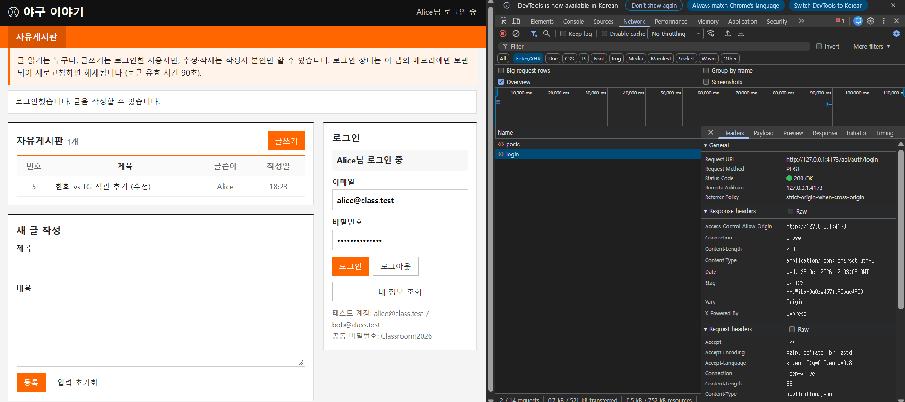
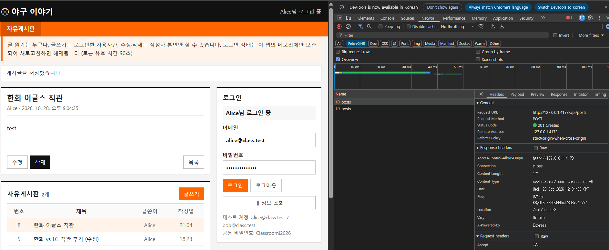
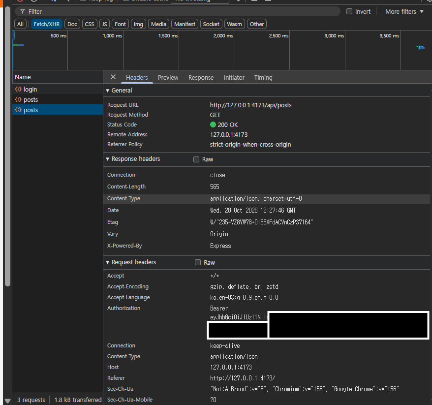
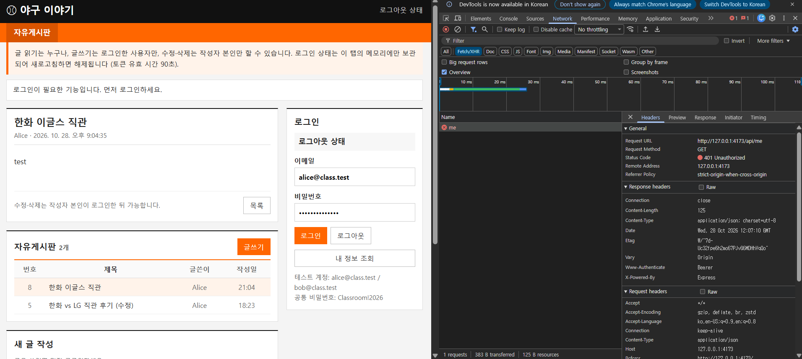
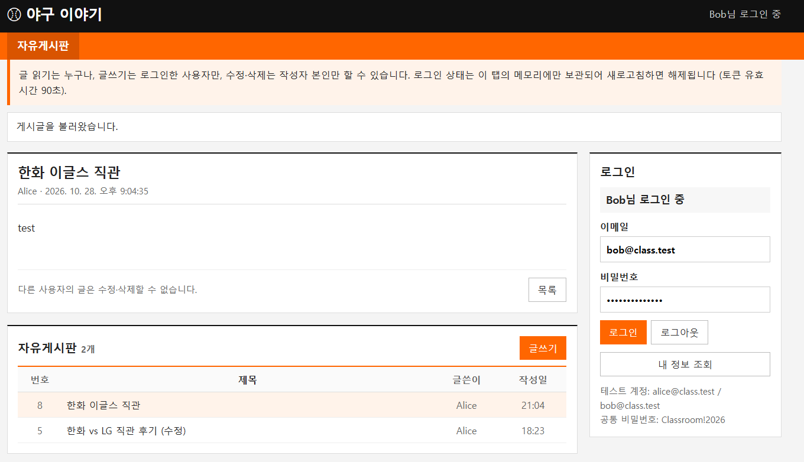
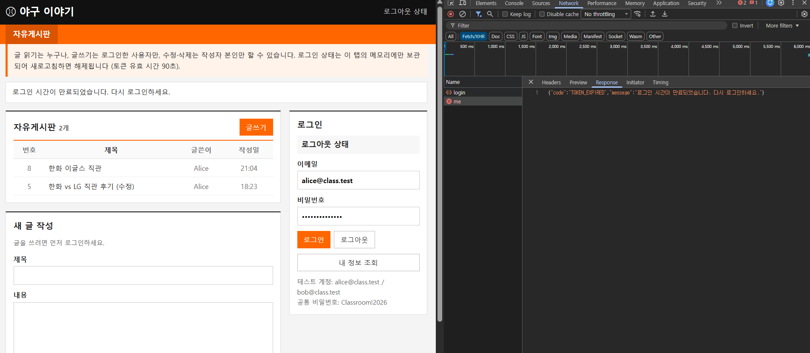
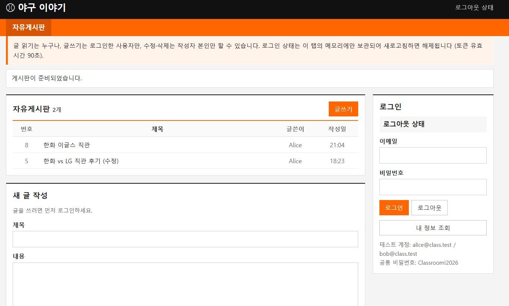

# JWT 게시판 구현 보고서 — ⚾ 야구 이야기 게시판

## 1 서비스 소개와 구현 범위

학번: 202524180  이름: 박은호  제출일: 2026-10-28

서비스 이름: 야구 이야기 게시판

기술 조합과 버전: React 19.3.0 (Vite 8.3.4) / Express 5.3.0 (jsonwebtoken 9.0.3, sql.js 1.14.2) / Node.js v22.18.0, Windows 11

GitHub 저장소 URL: https://github.com/Eunho-sp/webservice-jwt-board

소스 코드 기준: main 브랜치 (최종 제출 기준 커밋 SHA는 LMS에 제출)

야구 팬이 직관 후기나 경기 감상을 남기는 게시판입니다. 글은 누구나 읽고, 로그인한 사용자만 쓰며, 수정·삭제는 작성자 본인만 할 수 있습니다. 작성자는 요청 본문이 아니라 서버가 JWT를 검증해서 정합니다. 수업 예제와 제공 템플릿이 Express 기준이고 PC의 Node.js로 바로 실행할 수 있어 React + Express를 선택했습니다. 템플릿에서는 인증 TODO가 있는 `auth.js`, `api.js`와 화면 `main.jsx`·`style.css`만 바꾸고 CRUD·저장소·계정 코드는 유지했습니다.

| 기능 | 완료 여부 | 관련 파일 | 비고 또는 제한 |
|---|---|---|---|
| 공개 목록과 상세 | 완료 | app.js, store.js (제공 코드) | 토큰 없이 200 (T01) |
| 로그인과 JWT 발급 | 완료 | auth.js `loadSecret`, `issueToken` | 예시 키 거부 |
| 인증과 내 정보 조회 | 완료 | auth.js `currentUserId`, GET /api/me | 401을 3종 code로 구분 |
| 본인 글 작성·수정·삭제 | 완료 | auth.js `assertOwner`, app.js | 타인 글 403, DB 불변 |
| 만료·로그아웃·오류 표시 | 완료 | api.js, main.jsx | 401은 로그아웃, 403은 유지 |
| DB 데이터 유지 | 완료 | store.js (제공 코드) | 서버 재시작 후 유지 (T15) |

## 2 구조와 변경 내역

```
브라우저(React, :4173) ── Vite proxy ──▶ Express API(:8000) ──▶ backend/data/board.sqlite
[로그인]  POST /api/auth/login {email, password}
          → verifyCredentials → issueToken → 200 {accessToken, expiresIn, user}
          → 토큰·user를 api.js의 session 변수(메모리)에 저장
[글 수정] PUT /api/posts/5 + Authorization: Bearer <JWT>
          → currentUserId(토큰 검증) → 글 존재(404) → assertOwner(403) → 입력 검증(400) → 저장
```

토큰은 메모리에만 있어 새로고침하면 사라집니다. 토큰이 있으면 모든 요청에 Bearer 헤더를 붙이고(그림 3), 없으면 헤더를 만들지 않습니다. 서버는 /me·등록·수정·삭제에서만 토큰을 검사합니다.

| 변경한 파일과 함수 | 제공 코드의 원래 역할 | 내가 변경한 내용 | 변경 이유 | 작성 출처 |
|---|---|---|---|---|
| auth.js `loadSecret`, `issueToken` | 501 반환 | 키 검증(빈 값·예시 키·형식 오류 거부) 후 HS256으로 sub·exp·iss·aud 발급 | BE-01 | AI 초안 후 검토 반영 |
| auth.js `currentUserId` | 항상 ID 1 반환 | Bearer 파싱 → `jwt.verify` → exp·sub 검사 → 계정 확인, 401 code 3종 | BE-02 | AI 초안 후 검토 반영 |
| auth.js `assertOwner` | 빈 함수 | 사용자 ID ≠ authorId면 403 | BE-03 | AI 초안 후 검토 반영 |
| api.js | 빈 헤더, canEdit 항상 true | 토큰 메모리 저장, Bearer 헤더, 401이면 세션 해제, code별 문구, 작성자 비교 | FE-01\~04 | AI 초안 후 검토 반영 |
| main.jsx, style.css | 데모 화면 | 401·404 처리, 비로그인 안내, 표 형태 게시판 UI | FE-03·04, 주제 | AI 초안 후 검토 반영 |
| app.js, index.html | 콘솔 문구, 페이지 제목 | 문구·제목만 변경 | 주제 반영 | 본인 작성 |
| manual_tests.sh, check_claims.mjs | 없음 | 테스트 기록·클레임 검사 스크립트 추가 | 테스트 재현성 | AI 초안 후 검토 반영 |

## 3 핵심 코드 설명

### 3.1 로그인과 JWT 발급

파일 / 함수: `backend/src/auth.js` — `loadSecret`, `issueToken` / `backend/src/app.js` — `POST /api/auth/login`

```js
export function issueToken(user) {
  return jwt.sign({ sub: String(user.id) }, config.secret, {
    algorithm: "HS256", expiresIn: config.ttl, issuer: config.issuer, audience: config.audience,
  });
}
// app.js
const input = fields(req.body, { email: 254, password: 128 });   // 형식 오류 → 400 BAD_INPUT
const user = verifyCredentials(input.email, input.password);     // 제공 코드
if (!user) throw new ApiError(401, "INVALID_CREDENTIALS", "...");
const accessToken = issueToken(user);
res.json({ accessToken, expiresIn: Number(process.env.TOKEN_TTL || 90), user });
```

입력 형식이 틀리면 400 BAD_INPUT, 비밀번호가 틀리면 401 INVALID_CREDENTIALS이고, 맞을 때만 토큰을 발급합니다. payload에는 `sub`(사용자 ID)만 넣고 exp·iss·aud는 옵션으로 채웁니다. payload는 누구나 읽을 수 있으므로 비밀번호는 넣지 않습니다(강의 14\~15쪽). 서명 키는 `loadSecret`이 서버 시작 때 검사하며, 예시 키·빈 키로는 서버가 시작되지 않습니다. 성공 응답은 200과 `accessToken`, `expiresIn`, `user`입니다.

### 3.2 브라우저 토큰 저장과 전송

파일 / 함수: `frontend/src/api.js` — `session`, `authorizationHeaders`, `request`, `login`

```js
let session = { accessToken: "", user: null };          // 메모리에만 보관
function authorizationHeaders() {
  return session.accessToken ? { Authorization: `Bearer ${session.accessToken}` } : {};
}
export async function request(path, options = {}) {
  const response = await fetch(`/api${path}`, { ...options,
    headers: { "Content-Type": "application/json", ...authorizationHeaders(), ...options.headers } });
  const data = response.status === 204 ? null : await response.json();
  if (!response.ok) {
    if (response.status === 401) clearSession();      // 401: 로그인 해제, 403은 유지
    const code = data?.code;
    const error = new Error(MESSAGES[code] || data?.message || code || `HTTP ${response.status}`);
    error.status = response.status; error.code = code; throw error;
  }
  return data;
}
```

`login`이 성공하면 응답의 토큰과 user를 `session`에 넣고, 화면에 "Alice님 로그인 중"이 표시됩니다. 토큰이 없으면 헤더를 만들지 않아 `Bearer undefined`가 생기지 않습니다. 로그아웃과 401 응답은 `clearSession()`으로 토큰을 지우고, 403은 로그인이 유효하므로 지우지 않습니다. localStorage를 쓰지 않아 새로고침하면 로그인이 풀리는 것이 정상입니다.

### 3.3 서버 JWT 검증

파일 / 함수: `backend/src/auth.js` — `currentUserId`

```js
const header = req.get("Authorization") || "";
const parts = header.trim().split(/\s+/);
if (parts.length !== 2 || parts[0].toLowerCase() !== "bearer" || !parts[1])
  throw new ApiError(401, "TOKEN_REQUIRED", "...");
try {
  payload = jwt.verify(parts[1], config.secret, {
    algorithms: ["HS256"], issuer: config.issuer, audience: config.audience });
} catch (error) {
  if (error instanceof jwt.TokenExpiredError) throw new ApiError(401, "TOKEN_EXPIRED", "...");
  throw new ApiError(401, "INVALID_TOKEN", "...");
}
if (typeof payload.exp !== "number") throw new ApiError(401, "INVALID_TOKEN", "...");
if (typeof payload.sub !== "string" || !/^[1-9]\d*$/.test(payload.sub))
  throw new ApiError(401, "INVALID_TOKEN", "...");
const user = findPublic(Number(payload.sub));
if (!user) throw new ApiError(401, "INVALID_TOKEN", "...");
return user.id;
```

보호 API는 라우트 첫 줄에서 이 함수를 부릅니다. 헤더 형식 → `jwt.verify`(서명, HS256, 만료, iss, aud) → exp 존재와 sub 형식(강의 37\~38쪽 `validClaims`와 같은 역할) → 실제 계정 순서로 검사하고, 통과하면 사용자 ID만 돌려줍니다. 헤더가 없으면 TOKEN_REQUIRED, 만료면 TOKEN_EXPIRED, 나머지는 INVALID_TOKEN이며 모두 401에 `WWW-Authenticate: Bearer`가 붙습니다. 강의 실습은 없는 사용자에 `INVALID_USER`를 썼지만 과제 명세는 `INVALID_TOKEN`이라 명세를 따랐습니다. `jwt.decode`는 서명을 확인하지 않아 쓰지 않았습니다.

### 3.4 작성자 권한 검사

파일 / 함수: `backend/src/auth.js` — `assertOwner` / `backend/src/app.js` — POST·PUT·DELETE /api/posts

```js
export function assertOwner(userId, authorId) {
  if (userId !== authorId) throw new ApiError(403, "FORBIDDEN", "본인이 작성한 글만 ...");
}
// app.js (제공 코드)
app.put("/api/posts/:id", (req, res) => {
  const userId = currentUserId(req), id = postId(req), p = getPost(id); // 인증(401) → 존재(404)
  assertOwner(userId, p.authorId);                                      // 권한(403)
  res.json(store.update(id, fields(req.body, { title: 100, content: 5000 }))); // 입력(400)
});
```

토큰에서 검증한 사용자 ID와 DB에 저장된 `authorId`를 비교하고, 요청 본문은 쓰지 않습니다. 등록 시 작성자도 토큰의 ID로 정하며, 본문에 `authorId`가 있으면 400입니다(T12). 401은 인증(누구인지 모름), 403은 인가(누구인지는 알지만 권한 없음) 실패입니다(강의 11쪽). 403이면 저장 단계에 가지 않아 DB가 바뀌지 않습니다.

## 4 테스트 결과와 증거

실행 환경: Windows 11 / Node.js v22.18.0 / Chrome / 백엔드 `npm start`, 프론트 `npm run build` → `npm run preview`

로컬 배포 확인: 빌드 성공(`frontend_build.log`), 4173 접속과 `/api/health` 프록시 200 확인

테스트 일시 및 코드 버전: 2026-10-28, 최종 제출 커밋과 같은 코드로 테스트 (테스트 이후 코드 변경 없음, 문서만 수정)

토큰 TTL: 일반 90초 / 만료 테스트 3초

API는 curl로 테스트했고(`tools/manual_tests.sh`), 로그의 토큰은 가렸습니다. 증거 파일은 모두 `docs/evidence/`에 있습니다.

| ID | 수행 절차와 사용자 | 예상 결과 | 실제 HTTP와 code | 판정 | 증거 |
|---|---|---|---|---|---|
| T01 | 토큰 없이 목록·상세 조회 | 200 | 200 / 해당 없음 | PASS | log T01 |
| T02 | Alice 로그인 | 200, 화면 로그인 표시 | 200 / 해당 없음, alg HS256, sub "1" | PASS | 그림 1 |
| T03 | 틀린 비밀번호 / 없는 이메일 | 401 INVALID_CREDENTIALS | 401 / INVALID_CREDENTIALS | PASS | log T03 |
| T04 | 토큰 없이 /me, 글 등록 | 401 TOKEN_REQUIRED | 401 / TOKEN_REQUIRED | PASS | log T04 |
| T05 | Alice 글 등록, /me | 201, authorId 1 | 201 / Location 포함 · 200 | PASS | 그림 2 |
| T06 | Alice 본인 글 수정·삭제 | 200, 204 | 200 · 204 / 본문 없음 | PASS | log T06 |
| T07 | Bob이 Alice 글 수정 | 403, 원문 유지 | 403 / FORBIDDEN, 원문 동일 | PASS | log T07 |
| T08 | Bob이 Alice 글 삭제 | 403, 글 유지 | 403 / FORBIDDEN, 글 유지 | PASS | log T08 |
| T09 | 서명 변조 토큰으로 /me·등록·수정·삭제 | 401 INVALID_TOKEN | 401 / INVALID_TOKEN (4건) | PASS | log T09 |
| T10 | TTL 3초, 만료 후 /me·등록·수정·삭제 | 401 TOKEN_EXPIRED, 로그아웃 | 401 / TOKEN_EXPIRED (4건) | PASS | 그림 6 |
| T11 | 로그아웃 후 /me | 헤더 없음, 401 | 401 / TOKEN_REQUIRED | PASS | 그림 4 |
| T12 | 본문에 authorId·userId 추가 | 400 BAD_INPUT | 400 / BAD_INPUT, 미생성 | PASS | log T12 |
| T13 | 빈 제목·공백 본문·101자 제목 | 400 BAD_INPUT | 400 / BAD_INPUT, 원문 동일 | PASS | log T13 |
| T14 | 없는 글 조회·수정·삭제 | 404 NOT_FOUND | 404 / NOT_FOUND | PASS | log T14 |
| T15 | 서버 종료 후 재실행 | 글 유지 | 목록이 종료 전과 동일 | PASS | log T15 |
| T16 | 로그인 후 새로고침 | 글 유지, 로그인 해제 | 글 그대로, "로그아웃 상태" | PASS | 그림 7 |
| T17 | 토큰 없이 수정·삭제 / Bob 본인 글 | 401 / 본인 성공 | 401 · 201, 200, 204 | PASS | log T17 |

### HTTP 응답 확인 기록

| 확인 항목 | 기대 응답 | 실제 HTTP와 code | 증거 위치 |
|---|---|---|---|
| 정상 조회·로그인·수정 | 200 | 200 (T01, T02, T06) | log |
| 새 글 등록 | 201 및 Location | 201, `Location: /api/posts/5` | log T05, 그림 2 |
| 본인 글 삭제 | 204 및 빈 본문 | 204, 본문 없음 | log T06 |
| 입력 오류·추가 작성자 필드 | 400 BAD_INPUT | 400 / BAD_INPUT (T12, T13) | log |
| 잘못된 계정 | 401 INVALID_CREDENTIALS | 401 / INVALID_CREDENTIALS | log T03 |
| 토큰 없음·헤더 형식 오류 | 401 TOKEN_REQUIRED | 401 / TOKEN_REQUIRED | log T04, 그림 4 |
| 변조·클레임 오류 | 401 INVALID_TOKEN | 401 / INVALID_TOKEN | log T09, check_claims.log |
| 정상 서명의 만료 토큰 | 401 TOKEN_EXPIRED | 401 / TOKEN_EXPIRED | 그림 6 |
| 다른 작성자의 변경 | 403 FORBIDDEN | 403 / FORBIDDEN | log T07·T08 |
| 없는 글 | 404 NOT_FOUND | 404 / NOT_FOUND | log T14 |

- **WWW-Authenticate**: 보호 API의 401 응답 모두에 `WWW-Authenticate: Bearer`가 있었습니다(그림 4).
- **401과 403의 화면 차이**: 401이면 "로그아웃 상태"로 바뀌고 안내가 뜹니다(그림 4, 6). 403은 로그인 표시가 유지되고 권한 안내만 뜹니다.
- **데이터 불변**: T07·T08·T09·T13 실패 뒤 재조회한 글이 실패 전과 같았습니다.
- **없는 글 수정**: 토큰 없이 보내면 401 TOKEN_REQUIRED, 정상 토큰이면 404 NOT_FOUND였습니다.
- **자동 검사**: 교수님 제공 `check_api.py` final 40/40, expiry 48/48 PASS. 추가로 `check_claims.mjs`로 exp 누락·alg=none 등 잘못된 토큰 9건이 모두 401임을 확인했습니다.
- 브라우저 테스트와 캡처, 토큰 가림은 본인이 직접 수행했습니다.

### 증거 1: 로그인 성공과 토큰이 첨부된 요청

그림 1. Alice 로그인: "Alice님 로그인 중", `POST /api/auth/login` 200



그림 2. 글 등록: `POST /api/posts` 201, `Location: /api/posts/8`



그림 3. 요청 헤더 `Authorization: Bearer eyJhbGci…` (토큰 뒷부분 가림)



그림 4. 로그아웃 후 /me: 401, `WWW-Authenticate: Bearer`, Authorization 헤더 없음, "로그아웃 상태"



### 증거 2: Bob이 Alice의 글 수정·삭제를 시도한 서버 응답

서버 응답은 log T07·T08(403 FORBIDDEN, 원문 유지)에 있습니다. 화면에서는 수정·삭제 버튼이 보이지 않습니다.

그림 5. Bob이 Alice 글을 연 화면: "다른 사용자의 글은 수정·삭제할 수 없습니다."



### 증거 3: 토큰 변조·만료 시 서버 응답과 화면 처리

변조 응답은 log T09, 만료 응답 4건은 `manual_tests_T10_expiry.log`에 있습니다.

그림 6. 만료: /me 401 `TOKEN_EXPIRED`, "로그아웃 상태"와 만료 안내



그림 7. 새로고침(T16): 글은 그대로, "로그아웃 상태"



## 5 AI 활용과 참고 자료

AI 사용 여부: 사용

| 도구와 모델 | 사용 목적 | 반영한 파일 또는 보고서 항목 | 반영 방식 |
|---|---|---|---|
| Claude Code (Claude Fable 5.1) | 설계: 과제 문서 분석, 작업 순서 정리 | 작업 계획 (코드 미반영) | 참고 |
| Claude Code (Claude Fable 5.1) | 생성: BE-01\~03, FE-01\~04 코드 초안 | auth.js, api.js, main.jsx | 검토 후 그대로 반영 |
| Claude Code (Claude Fable 5.1) | 테스트: curl·클레임 검사 스크립트 | manual_tests.sh, check_claims.mjs | 검토 후 그대로 반영 |
| Claude Code (Claude Fable 5.1) | 문장 정리: README·보고서 초안 | README.md, report.md | 수정 후 반영 |
| Claude Code (Claude Opus 5.5) | 작업 순서 정리, UI 리뉴얼 코드(디자인 방향은 본인 결정) | main.jsx, style.css, report.md | 검토 후 수정 반영 |

### 대표 사례 1 — 서버 JWT 검증(BE-02)

- 도구 / 날짜: Claude Code / 2026-10-28
- 요청한 내용: "401을 TOKEN_REQUIRED / INVALID_TOKEN / TOKEN_EXPIRED로 구분하고 decode가 아니라 verify를 쓸 것"
- AI가 제안한 내용: `jwt.verify`에 algorithms·issuer·audience 지정, `TokenExpiredError`만 TOKEN_EXPIRED로 분리, exp 존재·sub 형식·계정 존재를 따로 검사
- 실제 반영 위치: `auth.js` `currentUserId`
- 내가 확인하고 수정한 내용: 강의(37\~38쪽)의 `validClaims`와 같은 역할인지 비교했고, exp 없는 토큰을 직접 만들어 보내 검사 줄이 없으면 통과한다는 것을 확인했습니다. 코드는 수정 없이 반영했습니다.
- 검증 방법과 결과: check_api 40/40, T04·T09·T10, check_claims 9건 모두 401

### 대표 사례 2 — 프론트 401/403 처리(FE-03)

- 도구 / 날짜: Claude Code / 2026-10-28
- 요청한 내용: "401이면 로그인 해제와 안내, 403은 유지, 404는 목록 갱신, 204는 JSON 파싱 금지"
- AI가 제안한 내용: `request`에서 401일 때 `clearSession()`, code별 문구 표 `MESSAGES`, 404면 상세를 닫고 목록 재조회
- 실제 반영 위치: `api.js` `request`, `MESSAGES` / `main.jsx` `run`
- 내가 확인하고 수정한 내용: 403에서 세션이 지워지지 않는지, 로그아웃 때 입력 중이던 내용도 지워지는지 확인했습니다.
- 검증 방법과 결과: 4173 화면에서 401 뒤 "로그아웃 상태" 확인(그림 4, 6)

### 대표 사례 3 — 테스트 증거 기록

- 도구 / 날짜: Claude Code / 2026-10-28
- 요청한 내용: "T01\~T17을 curl로 수행하고 토큰을 가린 로그로 남길 것"
- AI가 제안한 내용: 요청·응답 헤더·본문을 기록하고, 실패 뒤 재조회로 데이터 불변을 비교하는 스크립트
- 실제 반영 위치: `tools/manual_tests.sh`, `docs/evidence/*.log`
- 내가 확인하고 수정한 내용: 로그에 토큰 원문이 남지 않았는지 `eyJ`로 검색해 확인했습니다.
- 검증 방법과 결과: 모든 요청이 예상 HTTP/code와 일치

### 그 밖의 사용 내역 (요약)

| 단계 | 요청 | AI 제안과 반영 | 내가 확인한 것 |
|---|---|---|---|
| 계획 | 과제 문서를 읽고 작업 순서 정리 | 체크리스트 순서, 배점 우선순위 (코드 미반영) | 주제와 기술 조합은 본인 결정 |
| 환경 준비 | 템플릿을 제출 저장소로 정리 | 필요한 파일만 새 폴더로 복사, `.env` 키 생성 | `/api/health` 200, starter 검사 14/14 |
| BE-01 | 키 검증과 토큰 발급 | `loadSecret`, `issueToken` 그대로 반영 | 예시 키 거부, 로그인 200, exp−iat=90 |
| BE-03 | 작성자 권한 검사 | `assertOwner`로 403, 호출 순서는 제공 코드 유지 | T07·T08 403, 원문 유지 |
| UI 리뉴얼 | 주황·검정 표 형태 게시판 | `main.jsx`, `style.css`만 변경, 인증 로직 유지 | 빌드 성공, 화면 직접 확인과 캡처 |

### 참고 자료

| 자료 제목과 URL | 사용한 위치 | 반영 내용 및 출처 표시 |
|---|---|---|
| 교수님 제공 템플릿과 문서 (공지, API 명세, 테스트 시나리오, check_api.py) | 프로젝트 전체 | 템플릿 코드 유지, 상태 코드·처리 순서 기준 |
| 웹서비스설계 6주차 강의자료 「JWT 로그인」 | 3장, 6장 | 인증·인가 구분, `validClaims`, 401과 WWW-Authenticate, 로그아웃과 만료 |
| RFC 7519 (JWT), RFC 6750 (Bearer) — rfc-editor.org | 3.3, 6장 | 클레임 의미, Bearer 토큰 |
| node-jsonwebtoken — github.com/auth0/node-jsonwebtoken | auth.js | `jwt.sign`·`jwt.verify` 옵션, `TokenExpiredError` |
| Express 5 / Vite 공식 문서 | app.js, vite.config.js 이해 | 에러 핸들러, preview proxy |

## 6 이해도 확인과 회고

1. **요청 본문의 authorId를 믿으면 어떤 문제가 생기며, 내 코드는 어떻게 막는가?**

Bob이 본문에 `"authorId": 1`을 넣어 Alice 이름으로 글을 쓰거나 작성자를 바꿀 수 있습니다. 제 코드는 작성자를 토큰에서 검증한 ID로 정하고, 본문에 authorId·userId가 있으면 400 BAD_INPUT으로 거부합니다(T12). 수정할 때도 title·content만 바꿉니다.

2. **수정 버튼을 숨기는 것만으로 충분하지 않은 이유는 무엇이며, 서버의 어떤 함수가 권한을 검사하는가?**

버튼이 없어도 curl이나 개발자 도구로 요청을 직접 보낼 수 있기 때문입니다. 프론트의 `canEdit`는 편의 기능일 뿐이고, 실제 검사는 서버 `auth.js`의 `assertOwner`가 합니다. 작성자가 다르면 403을 반환해 저장 단계에 가지 못하게 합니다(T07·T08).

3. **JWT decode와 verify의 차이는 무엇이며, 내 코드는 어떤 검증을 수행하는가?**

decode는 base64url을 풀어 내용을 읽기만 하고 서명을 확인하지 않아, 내용을 고친 토큰도 그대로 읽힙니다. verify는 서버 비밀 키로 서명을 다시 계산해 비교하므로 고친 토큰은 실패합니다. 제 코드는 verify로 서명·HS256·만료·iss·aud를 검사하고, exp 존재, sub 형식, 사용자 존재까지 확인합니다.

4. **로그아웃, 토큰 만료, 새로고침은 각각 무엇을 바꾸는가? 이미 복사된 토큰은 어떻게 되는가?**

로그아웃은 브라우저 메모리의 토큰만 지우고 서버는 바뀌지 않습니다. 만료는 서버가 exp를 보고 401 TOKEN_EXPIRED로 거부하는 것이고, 프론트는 이때 토큰을 지웁니다. 새로고침은 메모리가 초기화되어 로그인만 풀리고 글은 DB에 남아 있습니다. 복사된 토큰은 로그아웃해도 만료(90초) 전까지 쓸 수 있습니다. Bearer는 "가진 사람이 쓸 수 있다"는 뜻이고, 즉시 무효화하려면 별도 서버 설계가 필요합니다(강의 33·49쪽).

5. **가장 어려웠던 오류 한 가지와 원인 확인·수정·재검증 과정을 설명하라.**

**(1) exp가 없는 토큰도 통과할 수 있는 문제**: 강의에서 `validClaims`로 exp 존재를 따로 확인한다고 배웠지만, 처음에는 "만료는 verify가 해 준다"는 것만 기억해서 왜 필요한지 와닿지 않았습니다. exp 없는 토큰을 직접 만들어 보내 보니 검사 줄을 빼면 통과하고 넣으면 401이 나왔습니다. exp가 없으면 영원히 쓸 수 있는 토큰이 되기 때문이었고, 최종 코드에서 잘못된 토큰 9건이 모두 401인 것을 확인했습니다.

**(2) 만료 테스트(T10)에서 토큰이 만료되지 않은 문제**: `set TOKEN_TTL=3 && npm start`로 서버를 켰는데 5초 뒤에도 로그인이 유지되었습니다. 토큰의 iat와 exp 차이가 90초여서, 서버가 처음부터 3초 토큰을 발급하지 않고 있었습니다. PowerShell에서는 `set`이 환경변수를 바꾸지 않기 때문이었고, `$env:TOKEN_TTL=3; npm start`로 다시 실행해 401 TOKEN_EXPIRED를 확인했습니다(그림 6). 코드보다 먼저 서버가 어떤 설정으로 떠 있는지 확인해야 한다는 것을 배웠습니다.

현재 남은 문제와 다음에 개선할 점: 없음 (의도된 제한: 새로고침 시 재로그인 필요, 로그아웃이 서버 측 토큰 무효화는 아님)

제출 확인: [x] 실제 코드와 설명 일치 [x] 테스트 직접 수행 [x] AI 활용 및 출처 기록 [x] 비밀 키와 토큰 제거

GitHub 확인: [x] 루트 README 작성 [x] 보고서 PDF와 증거 업로드 [x] README 문서 링크 확인 [x] 교수자 접근 가능(공개 저장소) [ ] 저장소 URL과 커밋 SHA 제출
